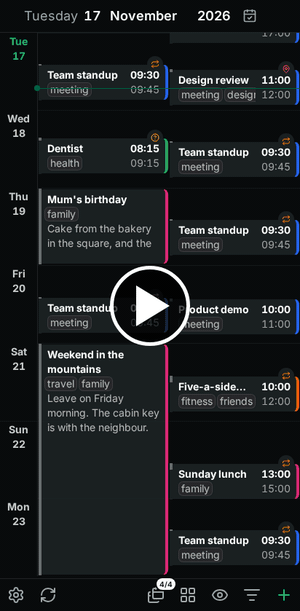

# Capibara Calendar

A complete calendar app optimized for mobile and desktop.

<p align="center">
  <a href="https://github.com/freddi301/capibara-calendar/releases/download/v0.1.0/showcase.mp4">
    
  </a>
</p>

## Webxdc

Calendario is the version that lives inside a chat, in [Delta Chat](https://delta.chat) or any other [webxdc](https://webxdc.org) messenger. Download `calendario.xdc` from the [latest release](https://github.com/freddi301/capibara-calendar/releases/latest), attach it to a chat, and tap it. Everyone in the chat shares the same calendar.

## Self-hosted

The web app talks to your own CalDAV server (Radicale, Baikal, Nextcloud…). A ready-to-run server is coming. Until then you can run it from source:

```
docker compose up -d
cd capibara-calendar-ui
npm install
npm run dev
```

## License

[AGPL-3.0](LICENSE)
